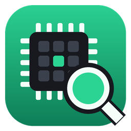

[](https://www.rust-lang.org)

<div align="center">



# MemPick

**Сканер и редактор памяти процессов для Windows.**
Находит в игре число, которое вы видите на экране, и даёт его поменять или заморозить.
Лёгкий нативный Cheat Engine без установки: один `.exe`, всё рядом с ним.

[](https://github.com/SchrodingerBox-Softworks/mem-pick/actions/workflows/rust.yml)
[](https://github.com/SchrodingerBox-Softworks/mem-pick/actions/workflows/release.yml)
[](https://github.com/SchrodingerBox-Softworks/mem-pick/releases/latest)
[](LICENSE)


</div>

> [!IMPORTANT]
> MemPick создан **в образовательных целях**: чтобы разобраться, как устроена
> память процессов в Windows. Используйте его только с программами, которые
> вам это разрешают, и **не нарушайте лицензии и пользовательские соглашения**
> программ, к которым подключаетесь. Подробности — в разделе
> [Ответственность и лицензии](#ответственность-и-лицензии).

---

## Что это

У вас 1 250 золота, а хочется 99 999. MemPick ищет это число в памяти игры,
после пары отсевов остаётся один адрес — его можно переписать, заморозить
или повесить на горячую клавишу.

- **Поиск по всей памяти** в несколько потоков: точное значение, больше/меньше,
  диапазон и **неизвестное значение** — для полосок здоровья и таймеров.
- **Отсев**: увеличилось, уменьшилось, изменилось, не изменилось, на сколько
  изменилось. Есть **шаг назад**.
- **Автопоиск**: число ищется сразу как целое 4 и 8 байт, `float` и `double`.
  Дробные сравниваются с округлением, как в Cheat Engine: `87` найдёт и `87.3`.
- Все типы: целые 1/2/4/8 байт со знаком и без, `float`, `double`, текст
  UTF-8 и UTF-16, **массив байт** с масками `48 8B ?? 05`.
- **Таблица адресов**: живые значения, правка прямо в ячейке, **заморозка**,
  описания. Сохраняется для каждой программы отдельно.
- **Указатели**: адреса вида `[[game.exe+1A2B]+10]+8` пересчитываются на лету.
- **Поиск указателей** — находит цепочку от статического адреса модуля до
  значения, чтобы таблица работала и после перезапуска игры.
- **Горячие клавиши** для записей: заморозить, записать, прибавить, убавить —
  прямо из игры, даже когда MemPick свёрнут.
- **Просмотр памяти** в hex: изменившиеся байты подсвечиваются, снизу —
  значение под курсором во всех типах сразу.
- **Таблицы Cheat Engine**: импорт `.CT` с адресами, указателями и типами,
  экспорт своих таблиц обратно в `.CT`.
- **Пауза процесса** на время поиска, чтобы значения не менялись посреди прохода.
- Тёмная, светлая и системная темы. Ничего не устанавливает и не пишет в
  `%AppData%` и реестр.

## Установка

Скачайте `mem-pick-vX.Y.Z-x86_64-windows.zip` со страницы
[Releases](https://github.com/SchrodingerBox-Softworks/mem-pick/releases/latest)
и распакуйте. Внутри готовая папка:

```
mem-pick-vX.Y.Z\
├─ mem-pick.exe
├─ README.txt
└─ LICENSE.txt
```

Запустите `mem-pick.exe`. Чтобы удалить программу, удалите папку.

Кладите её туда, где есть право на запись: `C:\Tools\MemPick\` подойдёт,
`C:\Program Files\` нет. Рядом с `.exe` появятся `settings.json`,
`app.ron` (размер окна) и папка `tables\`.

Сверить хэш из описания релиза:

```powershell
Get-FileHash .\mem-pick-vX.Y.Z-x86_64-windows.zip -Algorithm SHA256
```

## Как пользоваться

1. **Подключитесь к игре.** У игр есть окно, поэтому они наверху списка слева.
   Двойной клик по процессу — подключиться.
2. **Найдите число.** Введите значение с экрана и нажмите **Первый поиск**
   (или `Enter`).
3. **Отсейте лишнее.** Измените значение в игре (потратьте золото, получите
   урон), введите новое и нажмите **Отсеять**. Повторяйте, пока не останется
   пара адресов.
4. **Поменяйте или заморозьте.** Двойной клик по адресу добавит его в таблицу
   внизу. Клик по значению — правка, галочка слева — заморозка.

| Действие | Как |
| --- | --- |
| Подключиться | Двойной клик по процессу или кнопка **Подключиться** |
| Поиск / отсев | `Enter` в поле значения |
| В таблицу | Двойной клик по найденному адресу |
| Изменить значение | Клик по значению в таблице, `Enter` — записать |
| Заморозить | Галочка в первой колонке таблицы |
| Горячие клавиши | Клик по колонке **Клавиши** или правый клик по записи |
| Память, указатели | Правый клик по адресу: **Показать в памяти**, **Найти указатели** |
| Удалить запись | `Delete` или значок корзины |

### Режимы поиска

| Первый поиск | Отсев |
| --- | --- |
| Точное значение | Точное значение |
| Больше чем / Меньше чем | Увеличилось / Уменьшилось |
| Между | Увеличилось на / Уменьшилось на |
| Неизвестное значение | Изменилось / Не изменилось |
| | Больше чем / Меньше чем / Между |

**Неизвестное значение** снимает копию памяти. Дальше меняйте значение в игре
и отсеивайте по **Увеличилось** / **Уменьшилось** — так находятся полоски
здоровья, таймеры и всё, что игра не показывает числом.

### Адреса и указатели

Адрес в таблице — это выражение в синтаксисе Cheat Engine. Числа всегда
шестнадцатеричные:

```
7FF6A1B2C3D0             абсолютный адрес
game.exe+1A2B            модуль + смещение: переживает перезапуск игры
[[game.exe+1A2B]+10]+8   цепочка указателей: [ ] — прочитать указатель
```

### Поиск указателей

Адрес значения в куче меняется при каждом запуске. **Найти указатели на этот
адрес…** ищет цепочки от статического адреса модуля до значения:

1. Найдите значение обычным поиском, правый клик → **Найти указатели**.
2. Перезапустите игру, найдите значение снова и введите его новый адрес в
   **После перезапуска игры** → **Оставить подходящие**.
3. Двойной клик по оставшейся цепочке — она в таблице и работает всегда.

### Горячие клавиши

У каждой записи может быть несколько клавиш: `F1`, `Ctrl+F2`, `Alt+Shift+3`,
`Numpad5`. Действия те же, что в Cheat Engine: заморозить/разморозить,
заморозить, разморозить, записать значение, увеличить на, уменьшить на.
Клавиши глобальные: срабатывают прямо в игре.

### Таблицы Cheat Engine

**Импорт .CT…** загружает таблицу Cheat Engine: адреса, цепочки указателей,
типы и описания, включая записи внутри групп. Скрипты Auto Assembler и Lua —
это код, который CE внедряет в игру; MemPick так не делает, поэтому такие
записи пропускаются. **Экспорт .CT…** сохраняет вашу таблицу так, что её
откроет Cheat Engine.

## Настройки

Кнопка **Настройки** в правом верхнем углу. Всё пишется в `settings.json`
сразу, перезапуск не нужен.

| Параметр | По умолчанию | Что делает |
| --- | --- | --- |
| `theme` | `dark` | `dark`, `light` или `system` |
| `aligned` | `true` | Быстрый поиск: только выровненные адреса. В разы быстрее |
| `writable_only` | `true` | Искать только в изменяемой памяти, где и лежат значения игр |
| `include_mapped` | `false` | Искать и в отображённых файлах (обычно шум) |
| `auto_small_ints` | `false` | Добавить в автопоиск 1- и 2-байтовые целые |
| `max_results` | `10000000` | Сколько находок хранить. Каждая — 16 байт памяти |
| `pause_scan` | `false` | Ставить процесс на паузу на время поиска |
| `refresh_ms` | `200` | Как часто обновляются значения в таблицах |
| `freeze_ms` | `50` | Как часто переписываются замороженные значения |
| `hex_values` | `false` | Показывать целые в шестнадцатеричном виде |
| `only_windowed` | `true` | Показывать в списке только процессы с окнами |
| `remember_tables` | `true` | Сохранять таблицу адресов для каждой программы |

## Права администратора

Без прав администратора MemPick не откроет игры и программы, запущенные от
администратора. Бейдж **Обычные права** в правом верхнем углу перезапускает
MemPick с повышенными правами. С ними включается `SeDebugPrivilege`, и
открываются почти все процессы, кроме защищённых.

## Где лежат данные

```
MemPick\
├─ mem-pick.exe
├─ settings.json          # настройки
├─ app.ron                # размер и положение окна
└─ tables\
   ├─ game.exe.json       # таблица адресов для game.exe
   └─ notepad.exe.json
```

## Ответственность и лицензии

MemPick — учебный проект. Он показывает, как работают виртуальная память,
регионы и модули процесса, указатели и WinAPI для чтения и записи памяти.

- **Соблюдайте лицензии.** Подключаться к программе, читать и менять её
  память можно, только если это не запрещают её лицензия, пользовательское
  соглашение (EULA) или правила сервиса. Многие игры и программы прямо
  запрещают изменять память, обходить защиту и проводить обратную разработку.
- **Свои программы и одиночные игры.** Безопасное применение — собственные
  программы, учебные примеры и одиночные игры, где это не запрещено.
- **Никаких онлайн-игр и чужих аккаунтов.** Онлайн-игры с античитом (EAC,
  BattlEye, Vanguard и т. п.) считают чтение их памяти читерством: аккаунт
  заблокируют. Не используйте MemPick, чтобы получить нечестное преимущество
  над другими игроками или вмешаться в чужие данные.
- **Ответственность на пользователе.** Программа распространяется «как есть»
  по лицензии MIT, без каких-либо гарантий. Авторы не отвечают за блокировки,
  потерю данных, сбои программ и нарушения лицензий, которые допустил
  пользователь.

## Сборка

Нужен [Rust](https://rustup.rs/) 1.85+ и MSVC-toolchain.

```powershell
git clone https://github.com/SchrodingerBox-Softworks/mem-pick.git
cd mem-pick
cargo build --release
```

Бинарь появится в `target\release\mem-pick.exe`. То, что гоняет CI:

```powershell
cargo fmt --all -- --check; cargo clippy --all-targets -- -D warnings; cargo test
```

Тесты настоящие: они ищут, отсеивают, морозят значения и находят цепочки
указателей в памяти собственного тестового процесса.

## Как устроено

| Файл | Что внутри |
| --- | --- |
| [`src/main.rs`](src/main.rs) | Окно, тема, панели: процессы, поиск, результаты, таблица адресов |
| [`src/tools.rs`](src/tools.rs) | Окна-инструменты: указатели, горячие клавиши, память, `.CT` |
| [`src/process.rs`](src/process.rs) | WinAPI: процессы, регионы, модули, чтение и запись, пауза, права |
| [`src/scan.rs`](src/scan.rs) | Многопоточный поиск и отсев, снимок памяти, прогресс и отмена |
| [`src/pointer_scan.rs`](src/pointer_scan.rs) | Поиск цепочек указателей по обратной карте |
| [`src/value.rs`](src/value.rs) | Типы значений, разбор ввода, адресные выражения, маски байт |
| [`src/table.rs`](src/table.rs) | Таблица адресов, сохранение, поток заморозки |
| [`src/hotkeys.rs`](src/hotkeys.rs) | Глобальные горячие клавиши записей |
| [`src/memview.rs`](src/memview.rs) | Hex-просмотр памяти |
| [`src/cheat_table.rs`](src/cheat_table.rs) | Импорт и экспорт таблиц Cheat Engine |

Стек: [`eframe`/`egui`](https://github.com/emilk/egui) ·
[`egui_extras`](https://github.com/emilk/egui) ·
[`windows-sys`](https://github.com/microsoft/windows-rs) ·
[`global-hotkey`](https://github.com/tauri-apps/global-hotkey) ·
[`quick-xml`](https://github.com/tafia/quick-xml) ·
[`rfd`](https://github.com/PolyMeilex/rfd)

## Благодарности

Идеи поиска указателей, синтаксиса адресов, действий горячих клавиш и формат
`.CT` — из [Cheat Engine](https://github.com/cheat-engine/cheat-engine)
Эрика Хейнена. Код MemPick написан с нуля на Rust.

## Лицензия

[MIT](LICENSE)

## Автор


[**Schrodinger71**](https://github.com/Schrodinger71) — Discord: schrodinger71

<br clear="left">

